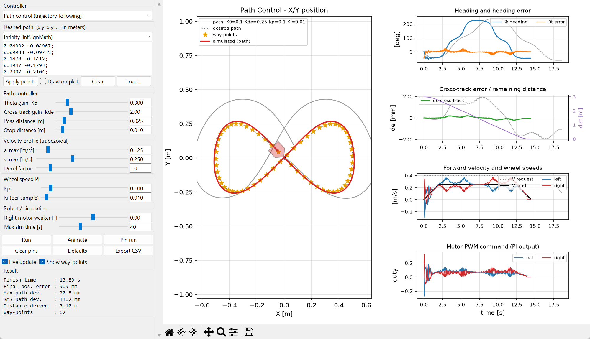

# ZumoPi Path Control Simulation (Python)

A Python port of the MATLAB/Simulink path control simulations
(`ZumoPi_V02/Matlab_Simulation`). It is used in the *Autonomous Systems Lab:
Path Control* pre-lab. Students can do the whole pre-lab without a MATLAB licence.

* **GUI** (`gui.py`): pick a controller and a path, move the gain sliders and watch
  the 2D path and the time responses update live.
* **Library** (`zumo_sim/`): readable Python versions of every block in the
  Simulink models. Students read and change these files.
* **Validated** against the original Simulink models: same trajectories within a few mm.
  See [Validation](#validation).



---

## 1. Setup

### 1.1 Install Python

Install **Python 3.10 or newer** from <https://www.python.org/downloads/>.

* **Windows:** during installation, tick **"Add python.exe to PATH"**. Keep the
  default **"tcl/tk and IDLE"** option ticked, because the GUI needs it.
* **macOS:** use the python.org installer. Homebrew Python needs `brew install python-tk`.
* **Linux (Debian/Ubuntu):** `sudo apt install python3 python3-venv python3-tk`

Check the version:

```bash
python --version
```

(On macOS/Linux use `python3` instead of `python` in all the commands below.)

### 1.2 Create a virtual environment

A virtual environment ("venv") keeps this project's packages separate from
the rest of your computer. Open a terminal **in this folder** and run:

```bash
python -m venv .venv
```

Activate it. You need to do this every time you open a new terminal:

| OS | Command |
|----|---------|
| Windows (PowerShell) | `.venv\Scripts\Activate.ps1` |
| Windows (cmd) | `.venv\Scripts\activate.bat` |
| macOS / Linux | `source .venv/bin/activate` |

Once it is active, the prompt starts with `(.venv)`.

> **Windows PowerShell error "running scripts is disabled"?** Run this once:
> `Set-ExecutionPolicy -Scope CurrentUser RemoteSigned`

### 1.3 Install the packages

```bash
pip install -r requirements.txt
```

| Package | Used for |
|---------|----------|
| `numpy` | vector math, arrays |
| `matplotlib` | all plots and the plots inside the GUI |
| `scipy` | only for reading the MATLAB reference `.mat` files (validation) |
| `tkinter` | GUI window. It ships with Python, so there is no pip package |

### 1.4 Check the installation

```bash
python -c "import numpy, matplotlib, tkinter; print('OK')"
python tools/validate_against_matlab.py
```

The second command compares the Python simulation with the MATLAB results
and prints a table (see [Validation](#validation)).

### 1.5 Using VS Code (optional)

Open the folder in VS Code. Press `Ctrl+Shift+P` and choose **Python: Select Interpreter**,
then pick `.venv`. You can now run any file with the ▶ button.

---

## 2. Running

### GUI

```bash
python gui.py
```

| Area | What it does |
|------|--------------|
| **Controller** | `Path control` (trajectory following), `Point to point` (multi way-point), or `Simplified open loop` (no wheel PI) |
| **Desired path** | Pick a preset, or type points as `x y; x y; ...` (MATLAB style) and press **Apply points**. **Draw on plot**: left-click adds a point, right-click removes the last one. **Load...** reads a 2-column txt/csv file |
| **Path controller** | `Kθ` heading-error gain, `Kde` cross-track-error gain, pass and stop distances |
| **Velocity profile** | `a_max`, `v_max`, deceleration factor (trapezoidal profile) |
| **Wheel speed PI** | `Kp`, `Ki` of the two motor speed controllers |
| **Robot / simulation** | Motor mismatch (one motor weaker, which is not in the MATLAB model) and the maximum simulation time |
| **Run / Animate** | Re-run. Animate plays the robot along the path with a time cursor |
| **Block diagram tab** | The control structure of the selected controller, laid out like the Simulink model. The outer position loop is blue, the inner wheel-speed PI loops orange, unused blocks grey. Blocks show the current gain values |
| **Disabled sliders** | Parameters that have no effect in the selected mode are greyed out. Kde in P2P (no cross-track error). In open loop: Kθ, Kde, pass distance, velocity profile and PI (it uses fixed internal gains) |
| **Animation speed** | Replay speed ×1 … ×20 real time (default ×5). It can be changed while the animation runs |
| **Pin run** | Keeps the current result on the plot (in grey) so you can compare it with new gains |
| **Export CSV** | Saves all signals of the current run |
| **Result** | Finish time, final position error, max/RMS deviation from the desired path |

Slider changes re-run the simulation automatically ("Live update"). You can also type a value
into a box and press Enter; typed values may go outside the slider range.
Use the matplotlib toolbar (bottom) to zoom and to save the figure as PNG.

### Scripts

| Script | MATLAB equivalent | Purpose |
|--------|-------------------|---------|
| `examples/plot_script.py` | `plotScript.m` | Run P2P + Path on `DesiredCoordinates` and plot both |
| `examples/gain_sweep.py` | – | Sweep one gain, compare trajectories and the error table |
| `examples/wheel_step_response.py` | – | Open-loop and PI step response of a single wheel |
| `examples/custom_controller.py` | – | Template for writing your own controller (look-ahead example) |

Minimal use from your own code:

```python
from zumo_sim import ZumoParams, simulate, paths

pts = [[0, 0.5], [0.5, 0.5], [0.5, 1.0]]
r = simulate(pts, mode="path", params=ZumoParams(k_theta=0.3, k_de=1.0))
print(r.metrics())
import matplotlib.pyplot as plt
plt.plot(r.x, r.y); plt.axis("equal"); plt.show()
```

`SimResult` fields (arrays over time): `t, x, y, phi, v_request, v_cmd, theta_t,
de, dist, en, wl_sp, wr_sp, wl, wr, ul, ur, target_idx`.

---

## 3. Project structure

```
ZumoPi_V02/Python_Simulation/
├── gui.py                      interactive simulator
├── requirements.txt
├── zumo_sim/
│   ├── params.py               InitZumo.m + all block gains (one dataclass)
│   ├── controllers.py          Path / P2P / open-loop controllers   <- students edit
│   ├── simulation.py           block-diagram wiring, rate limiter, metrics
│   ├── motor.py                DC motor + gearbox + Hall encoder, PI controller
│   ├── odometry.py             encoder position estimation
│   ├── diagram.py              block diagram drawing (GUI "Block diagram" tab)
│   └── paths.py                preset paths, point parsing, C++ export
├── examples/                   scripts listed above
├── tools/
│   ├── validate_against_matlab.py
│   ├── build_manual.py         builds the Python edition of the student manual
│   └── matlab/                 scripts that generated the reference data
├── reference_data/             .mat files exported from the Simulink models
├── docs/                       screenshots / figures (README and manual)
└── validation/                 plots written by the validation script (not in git)

The student manual (Python edition) is in `ZumoPi_V02/EducationalMaterials/`.
```

### MATLAB → Python mapping

| Simulink model / block | Python |
|------------------------|--------|
| `InitZumo.m` | `zumo_sim/params.py` → `ZumoParams` |
| `ZumoSimulatiom_Path_Control.slx` | `simulate(pts, "path")` |
| `ZumoSimulatiom_P2P_MultiPoint.slx` | `simulate(pts, "p2p", ZumoParams(decel_factor=2))` |
| `ZumoSimulatiom_P2P.slx` | `simulate([[-1, 1]], "p2p", ...)` (one point) |
| `Simplified_OpenLoop.slx` | `simulate([[-1, 1]], "open_loop")` |
| *Path Control* MATLAB function | `controllers.PathController` |
| *Point to Point Control* MATLAB function | `controllers.P2PController` |
| *Rate Limiter* + *Saturation* | `simulation.RateLimiter`, `v_max` clip |
| *Theta_t Gain*, *de Gain* | `k_theta`, `k_de` |
| *Discrete PID Controller* (PI, clamping) | `motor.PIController` |
| *DC Motor Simulation* (Simscape motor, H-bridge, gear, Hall encoder) | `motor.WheelDrive` |
| *Encoder Position Estimation* | `odometry.Odometry` |
| *Delay* (pose feedback, 1 sample) | `x_prev, y_prev, phi_prev` in `simulate()` |
| `Record_Path.signals.values(:,1:2)` | `r.x, r.y` |

---

## 4. Model notes (for instructors)

* **Motor model.** The Simscape network is reduced to its exact equivalent: a
  first-order wheel-speed model, τ·ẇ = K·u − w. Here τ = J·R/Kₑ² = 0.168 s and
  K = 30.7 rad/s per unit duty, derived from the motor block data (stall torque,
  no-load speed, 4 V bridge, 75:1 gear). The electrical time constant is 50 µs and
  can be neglected. The Hall encoder (3 pulses per motor revolution) and its
  pulse-period decoder with a one-sample delay are simulated as well.
  Open-loop error against Simscape is about 1 % RMS.
* **PI integrator.** Simulink's PID block runs its integrator in *Accumulation*
  mode (`gainval = 1`), so the integral is `Σ Ki·e` **without** `Ts`. `Ki = 0.01`
  is therefore 1.0 s⁻¹ in continuous time. The Python port does the same.
* **Units quirk kept from the original.** The wheel speed set point is
  `v/(2πr)` (rev/s), while the motor feedback is in rad/s. The odometry
  integrates the feedback as rev/s. The simulation is self-consistent, but the
  "plant gain" seen by the PI is 2π larger than the physical one, so the PI
  gains from simulation do not carry over 1:1 to the robot.
* **Sign convention kept from the original.** In the odometry a faster
  **left** wheel *increases* Φ.
* **Known behaviour of the original algorithm (reproduced on purpose).**
  * With the default gains, Path control does **not finish the square or zig-zag
    paths**. It overshoots a corner by more than `pass_distance`, and the "next
    point is closer" check never fires, so it drives away. Students can fix this
    by tuning, by a larger pass distance, or by changing the code.
  * On curved paths the "drove past the last point" condition can stop the robot
    several cm before the end.
  * In Path mode with only one point that lies behind the robot, the robot stops at once.
    Use P2P mode for single targets (the GUI switches to it automatically).

## Validation

`python tools/validate_against_matlab.py` runs the same cases as the Simulink
reference exports and compares them:

| path | mode | max ΔPos [mm] | RMS ΔPos [mm] | stop time MATLAB / Python [s] |
|------|------|------:|------:|------:|
| line 2 m | path | 4.5 | 0.3 | 9.51 / 9.51 |
| line 2 m | p2p | 3.2 | 0.3 | 9.58 / 9.58 |
| square | path | 5.1 | 3.8 | did not finish / did not finish |
| square | p2p | 4.7 | 0.9 | 10.22 / 10.21 |
| infinity | path | 5.3 | 0.6 | 18.07 / 18.07 |
| infinity | p2p | 15.3 | 3.3 | 14.27 / 14.23 |
| point (-1,1) | open loop | 12.2 | 3.1 | – |

Overlay plots are written to `validation/`. To regenerate the reference data you
need MATLAB with Simulink and Simscape Electrical: run `tools/matlab/runRef.m` from
the `ZumoPi_V02/Matlab_Simulation` folder.

## Student manual (Python edition)

`ZumoPi_V02/EducationalMaterials/ZumoPiV02 - Autonomous Systems Lab - Path Control (Python).docx`
(and `.pdf`)
is the original manual with the MATLAB pre-lab (section 7) rewritten for this simulator.
It also adds section 6.2 (the PI code used in the simulation) and a Python version
of the Appendix A C++ export script. To regenerate it from the original .docx:

```bash
pip install python-docx
python tools/build_manual.py      # reads/writes ../EducationalMaterials
```
